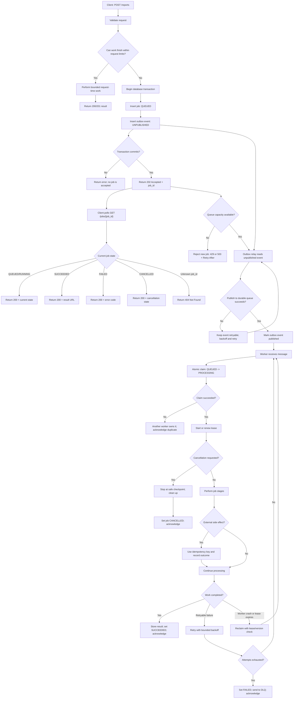

# Topic 12 — Background Job End-to-End Flow

This diagram connects the request, database, outbox, queue, worker, client polling, retry, cancellation, idempotency, and backpressure decisions.



## Main guarantees and limits

| Concern | Design response | Important limit |
|---|---|---|
| API request timeout | Return 202 Accepted with a job ID | 202 means accepted, not completed |
| Database and queue dual write | Transactional outbox | Relay may publish a duplicate |
| Duplicate delivery | Stable event ID and idempotent consumer | Exactly-once side effects are difficult |
| Worker crash | Lease or visibility timeout | Reclaim requires version or fencing checks |
| Queue overload | Backpressure, quotas, scaling, and load shedding | A queue cannot create processing capacity |
| Cancellation | Durable cancel request and cooperative checkpoints | External side effects may not be reversible |
| Failed processing | Bounded retry and dead-letter queue | Permanent failures require investigation |
| Client visibility | Job-status endpoint and result reference | Progress may not always be measurable |

## State transition summary

```text
QUEUED
  ├──> RUNNING ───> SUCCEEDED
  │       ├───────> FAILED
  │       ├───────> CANCELLING ───> CANCELLED
  │       └───────> lease expires ───> reclaim or retry
  └──> CANCELLED
```
